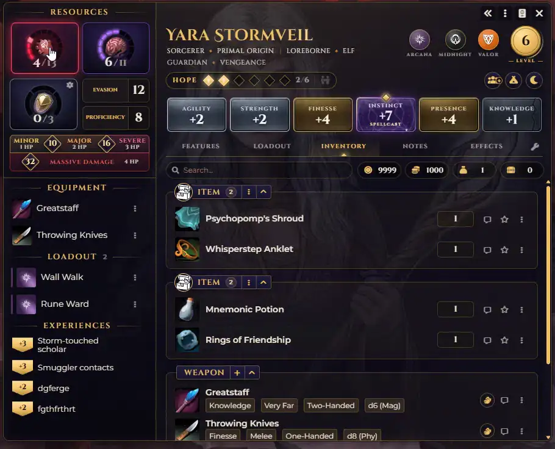
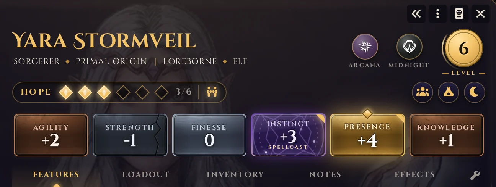
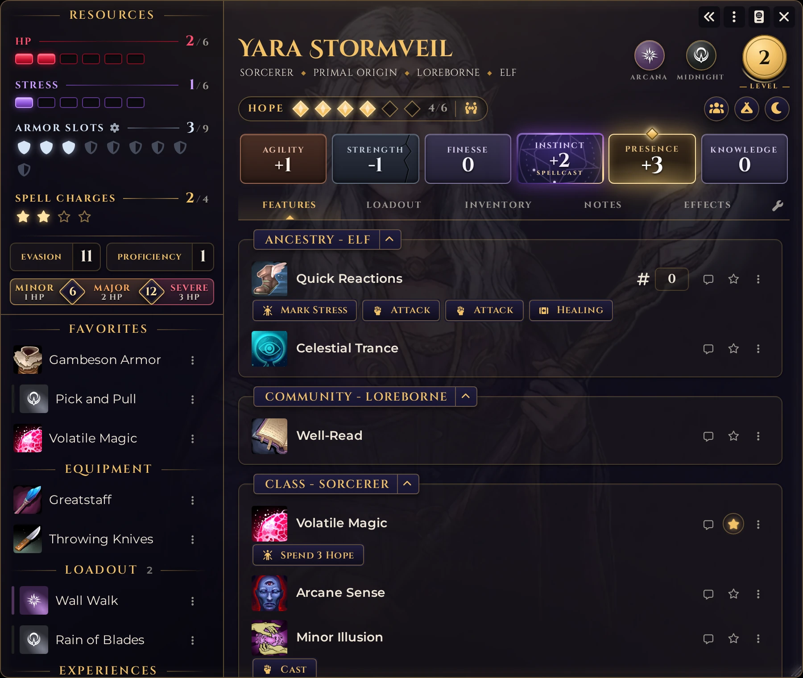
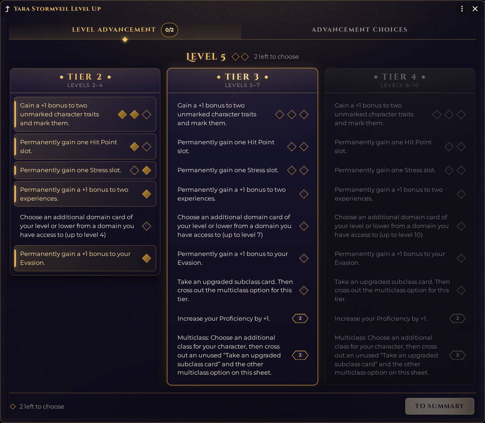
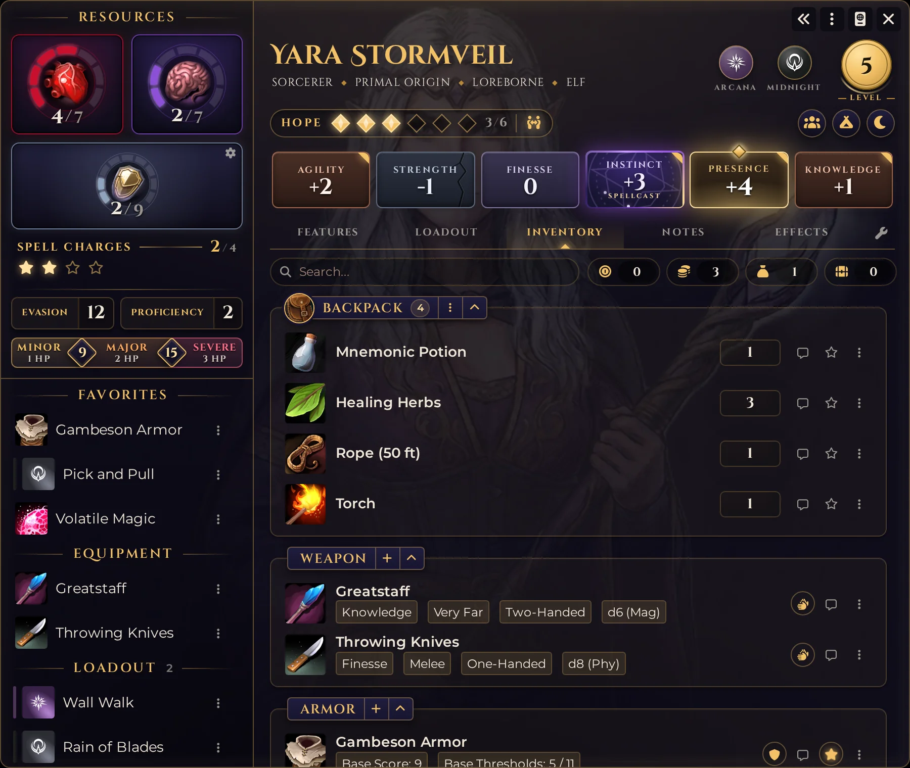
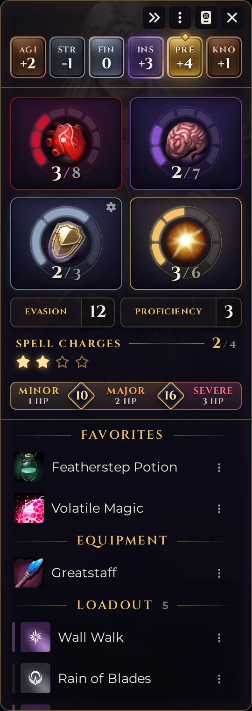
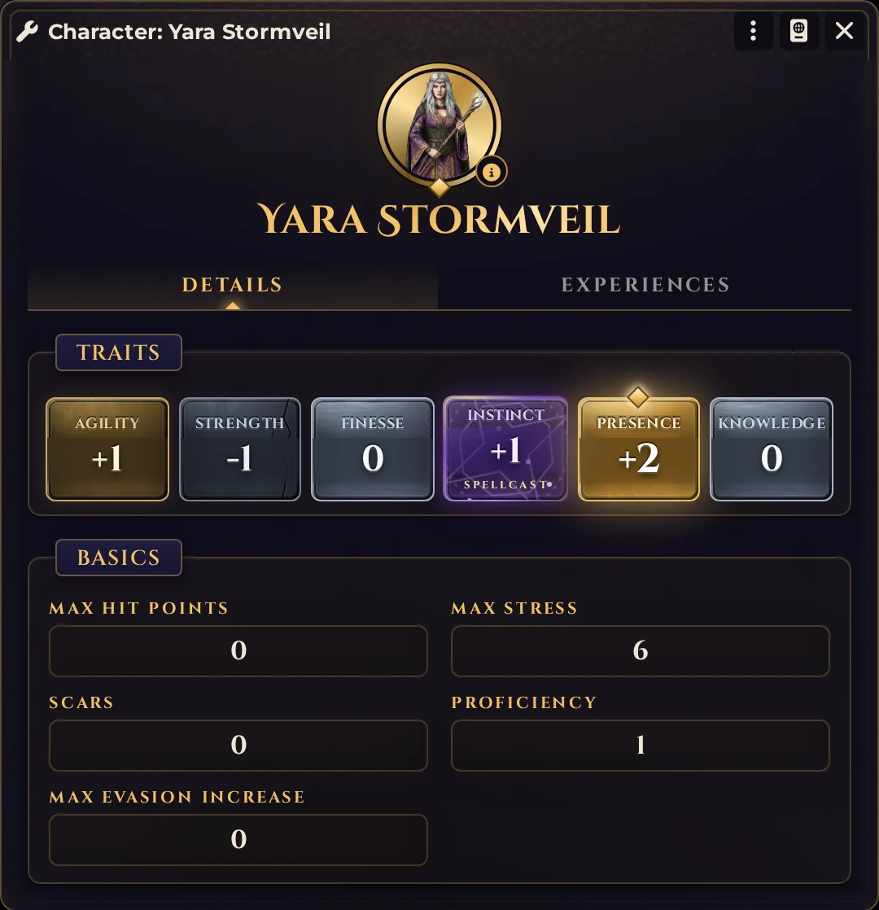
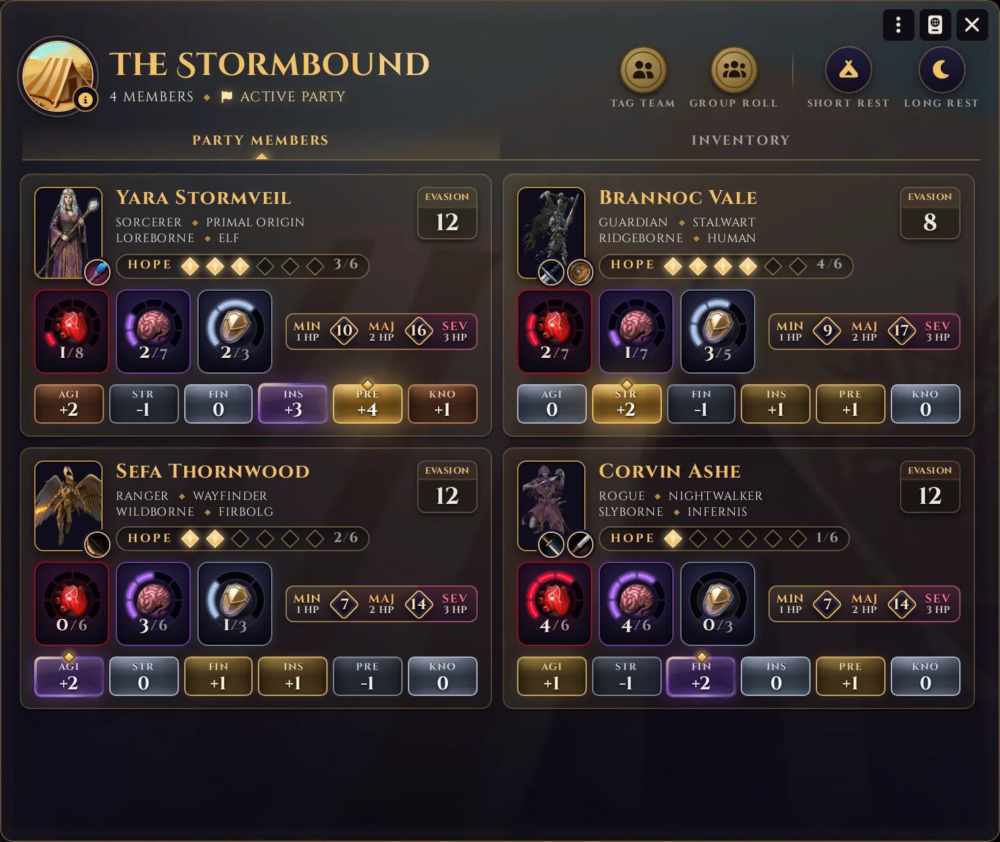
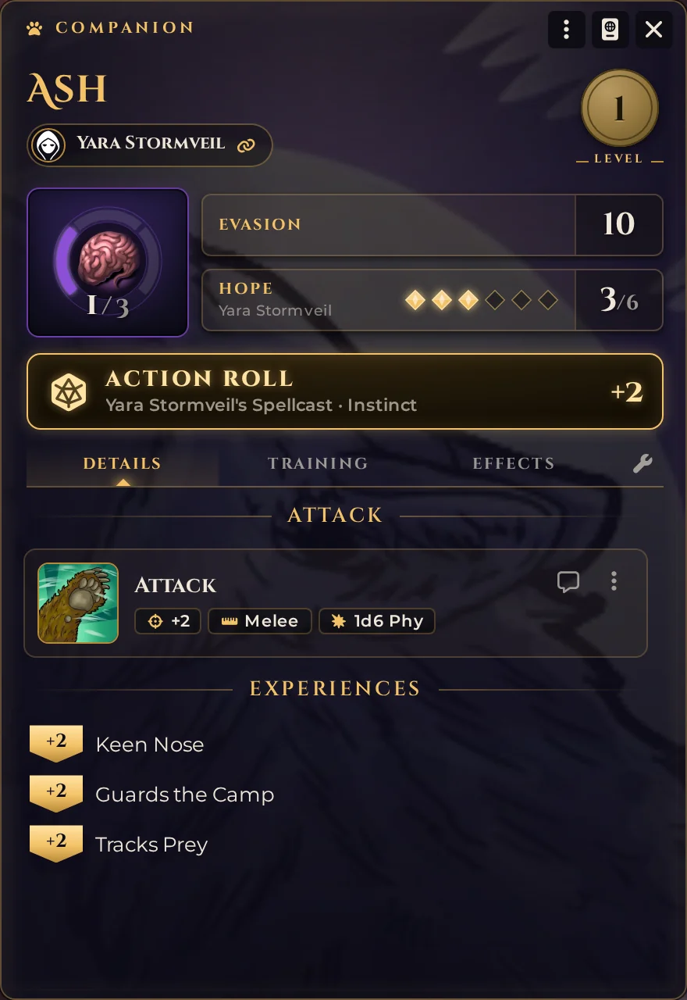

# Daggerheart: Nice Sheets

Daggerheart: Nice Sheets is a second character sheet for the Daggerheart system. Once the module is enabled, characters, companions and parties open in it by default, unless the GM has already chosen another **Default Sheet**. Rolls, actions, context menus and drag and drop all run through the system's own code, so the game plays the same.

What changes is the layout. Hit Points, Stress and Armor stay in view in a sidebar, with Hope in the header above the traits. The six traits sit on plaques ranked from cracked iron to gold, and the character's art fills the background of the whole sheet.

<p align="center"></p>

[](https://buymeacoffee.com/mestredigital) [](https://mestredigital.online/pages/projetos-en)

## What the sheet shows

The sidebar holds the numbers you check during a fight. Hit Points, Stress and Armor Slots are cards with a ring around an icon, one segment per slot and the count in the gap at the bottom. A left click on a card marks one, and a right click clears one. Extra resources, the ones the GM adds in the homebrew settings and the ones a feature grants, appear under Armor as tracks of their own. Below them are Evasion, Proficiency and the damage thresholds, with the Hit Points each band costs. When the Massive Damage variant rule is on, a fourth band shows the value that marks 4 Hit Points.

Further down the sidebar lists your favorites, your equipped weapons and armor, the domain cards in your loadout, and your experiences, each with a button that sends it to chat.

The header has the character's class, subclass, community and ancestry, the domains, the level, and Hope. Click a heritage name to open its item. The Tag Team icon at the end of the Hope row lights up when the character has the Hope a Tag Team costs (3 in the system's default), and a click opens the system's Tag Team window for the character's party. A character in no party gets a chat card asking the table for one instead. Nothing is spent by the click. The buttons on the right start a short or a long rest, and open the party when the character is in one. A character in more than one party gets a small plus on that button, and a click lists the parties to pick from.

<p align="center"></p>

Each trait plaque takes its material from where the value ranks among the character's own traits. The lowest is cracked iron, the highest is gold with a crest on top, and the values between are steel, bronze and brass. Equal values always get the same material. The spellcasting trait is violet glass, with a ring of light turning around its border. Click a plaque to roll that trait. Hold the mouse over it to see three things the trait is used for, such as Sprint, Leap and Maneuver for Agility.

When Hit Points, Stress or Armor change, the card shakes and turns red for a loss, and lifts and turns green for a recovery. Gaining Hope lights up the character's art for a moment.

<p align="center"></p>

## Leveling up

Clicking the level medal asks before raising the level, then opens the level-up manager. When a level up is already waiting, the medal glows and the click reopens the manager. At the last level the medal does nothing.

The level-up manager is the system's, in the sheet's style. Each advancement is a row with one gem per pick, and clicking the gem or the row's text takes it. The line above the tiers counts the picks the level has left. The choices tab lists what those picks still need, such as a trait or a domain card, one numbered step at a time, and the footer says what is missing before you can move on.

<p align="center"></p>

## Inventory and containers

Any loot item can hold other items. Right-click it and choose **Use as container**, and it becomes a panel at the top of the Inventory tab. Drag weapons, armor, consumables or loot onto the panel to store them, and drag them anywhere else in the tab to take them out. **Take out of the container** in an item's menu does the same.

<p align="center"></p>

A few rules keep the inventory consistent:

- An equipped item can't go in a container, and equipping a stored item takes it out.
- Containers don't go inside other containers.
- **Stop using as container**, or deleting the container, leaves everything it held loose in the inventory.
- An item dragged from another character, from the sidebar or from a compendium onto a container is stored there as it arrives. This also works when you don't own the other character and the GM's client makes the transfer.

The currencies the GM enabled in the homebrew settings sit next to the search field. The star on an item row pins it to the Favorites section of the sidebar. Items the sidebar already lists, like equipped gear and loadout cards, have no star.

Every group in the Features and Inventory tabs can be collapsed with the arrow on its title. The sheet remembers which groups you collapsed, per character, on that computer.

## Notes

The Biography tab is now Notes: a text field that saves as you type. The system's biography fields (pronouns, age, faith, background and connections) are hidden. To show them below the notes, turn on **Show the biography under Notes** in the module settings. It is a setting of your user, so each player chooses for themselves.

## Collapsing to the sidebar

The arrows button in the window header shrinks the sheet to the sidebar alone, with the traits in a strip at the top and Hope as a fourth card next to Hit Points, Stress and Armor. Click it again to bring the full sheet back. The sheet remembers it per character, on that computer.

<p align="center"></p>

## The settings window

The wrench at the end of the tabs opens the character's settings, in the same style as the sheet. Trait values are typed straight into the plaques, and the experiences tab edits names, values and descriptions. Click the portrait to change the character's art. The small info icon next to it explains what kind of image works best as the sheet's background.

<p align="center"></p>

A player with only Limited permission on a character sees a short card instead of the sheet: the portrait, the name, the heritage, the level, the domains, and the pronouns, age and faith when they are filled in.

## The party sheet

The party sheet puts every member on one page. Each character has a card with the heritage, Hope, Hit Points, Stress and Armor, Evasion, the damage thresholds and the six traits, ranked in the same materials as on the character sheet. The equipped weapons sit on the corner of the portrait, and a click on the portrait or the name opens the character. On the characters you own, Hope and the resource cards take the same clicks as on the character sheet. The traits only show values, so nothing is rolled from here. Companions and adversaries in the party are listed in groups of their own.

<p align="center"></p>

The buttons at the top start a Tag Team or a Group Roll, and light up while one is under way. The GM also gets buttons for a short and a long rest. When the system's **Hide Party Stats** setting hides the stats from you, the cards show only the portrait, the name and the heritage.

The Inventory tab works like the character's, containers included, with the party's coins next to the search field. The party's Notes tab is hidden. The GM can show it with **Show the party Notes tab** in the module settings.

## The companion sheet

A companion opens in its own small sheet. The companion's art sits faint behind the whole sheet, as on the character sheet, and is changed with the portrait in the settings window (the wrench). Stress is a ring card that takes the same clicks as the character's: left click marks one, right click clears one. Evasion sits beside it, and below it the partner's Hope, which pays for the companion's features. The partner's owners can change it there by clicking its gems.

Under the name is the partner. Click it to open the partner's sheet. A companion with no partner shows **No partner** there instead, and the click opens the settings window, where the partner is chosen. The **Action Roll** button is near the top, with the partner's Spellcast trait and its modifier. When the companion marks its last Stress, the sheet turns grey and says it is out of the scene until the partner's next long rest.

<p align="center"></p>

The Details tab has the attack, which rolls when you click its image, and the experiences, each with a button that sends it to chat. Effects are in their own tab.

The Training tab lists the eight companion upgrades, with the marks each one has, and says how many choices are still pending. The choices are made in the system's companion level-up window, which opens from the level medal when one is waiting.

## How to use it

Enable the module and open a character or a party. It opens in the Nice Sheet.

To use the system's sheet for one character:

1. Open the character sheet.
2. In the window menu, choose **Configure Sheet**.
3. Pick the system's sheet in **This Sheet** and save.

To change it for the whole world, the GM picks the sheet in **Default Sheet** in the same window. A character with its own choice in **This Sheet** keeps it. Disabling the module also brings back the system's sheet.

The first time a player opens their character in another sheet, the module asks once whether to switch to the Nice Sheet. A player who says no is not asked again. The GM can turn this off with **Suggest the Nice Sheet to players** in the module settings.

## When Daggerheart updates

The sheet reads parts of the Daggerheart system that can change between versions. If an update breaks something, the sheet still opens with what the system provides, or the system's own sheet opens in its place, and a message tells you to switch back to the system's sheet in **Configure Sheet** until Nice Sheets is updated. The GM can also change the **Default Sheet** for the whole world.

## For module developers

Other modules can add, remove or reorder the buttons at the top of the party sheet through a hook. [docs/DEVELOPERS.md](docs/DEVELOPERS.md) explains how.

## Translations

The module ships in English. To translate it, open an [issue](https://github.com/brunocalado/dh-nice-sheets/issues) and attach a translated copy of [lang/en.json](lang/en.json), with the code of your language (for example `fr`, `de` or `pt-BR`). I add the file to the module in the next update. To update a translation later, do the same with the new file.

## Installation

Download the [latest release](https://github.com/brunocalado/dh-nice-sheets/releases/latest), or paste this manifest link in **Install Module**:

```
https://github.com/brunocalado/dh-nice-sheets/releases/latest/download/module.json
```

It needs Foundry VTT v14 and the Daggerheart system, version 2.10.13 or later.

## ⚖️ Credits & License

* **Code License:** GNU GPLv3.

* **Textures:** derived from [ambientCG](https://ambientcg.com) materials, released under CC0 1.0. Details in [docs/CREDITS.md](docs/CREDITS.md).

* **Disclaimer:** This module is an independent creation and is not affiliated with Darrington Press.

# 🧰 My Daggerheart Modules

| Module | Description |
| :--- | :--- |
| 💀 [**Adversary Manager**](https://github.com/brunocalado/daggerheart-advmanager) | Scale adversaries instantly and build balanced encounters. |
| 🖼️ [**Art Mapper**](https://github.com/brunocalado/dh-assets) | Automatically assigns artwork to system compendiums, actors, tokens, and custom module content — keeping your visuals organized and up to date. |
| 🐉 [**Colossus**](https://github.com/brunocalado/dh-colossus) | Manage massive multi-part boss encounters with independent HP per part and a single shared stress pool. |
| 💥 [**Critical**](https://github.com/brunocalado/daggerheart-critical) | Animated criticals. |
| 💠 [**Custom Stat Tracker**](https://github.com/brunocalado/dh-new-stat-tracker) | Add custom trackers to actors. |
| ☠️ [**Death Moves**](https://github.com/brunocalado/daggerheart-death-moves) | Enhances the Death Move moment with a dramatic interface and full automation. |
| 📏 [**Distances**](https://github.com/brunocalado/daggerheart-distances) | Visualizes combat ranges with customizable rings and hover calculations. |
| 📦 [**Extra Content**](https://github.com/brunocalado/daggerheart-extra-content) | Homebrew content pack. |
| 😱 [**Fear Tracker**](https://github.com/brunocalado/daggerheart-fear-tracker) | Adds an animated slider bar with configurable fear tokens to the UI. |
| 🧟 [**Horde**](https://github.com/brunocalado/dh-horde) | Explode single horde tokens into dozens of individual tokens and manage their movement and stats automatically. |
| 🎁 [**Mystery Box**](https://github.com/brunocalado/dh-mystery-box) | Introduces mystery box mechanics for random loot and surprises. |
| 📝 [**Nice Sheets**](https://github.com/brunocalado/dh-nice-sheets) | An alternative character sheet with a resource sidebar, ranked trait plaques, and the character's art filling the background. |
| ⚡ [**Quick Actions**](https://github.com/brunocalado/daggerheart-quickactions) | Quick access to common mechanics like Falling Damage, Downtime, etc. |
| 📜 [**Quick Rules**](https://github.com/brunocalado/daggerheart-quickrules) | Fast and accessible reference guide for the core rules. |
| 🤖 [**Resource Macros**](https://github.com/brunocalado/daggerheart-fear-macros) | Automatically executes macros when the Fear, Hope, Stress, HP, or Armor resources change. |
| 🎲 [**Stats**](https://github.com/brunocalado/daggerheart-stats) | Tracks dice rolls from GM and Players. |
| 🧠 [**Stats Toolbox**](https://github.com/brunocalado/dh-statblock-importer) | Import actors using a statblock. |
| 🛒 [**Store**](https://github.com/brunocalado/daggerheart-store) | A dynamic, interactive, and fully configurable in-game store. |
| 🔍 [**Unidentified**](https://github.com/brunocalado/dh-unidentified) | Obfuscates item names and descriptions until they are identified by the players. |
| 🌌 [**Void**](https://github.com/brunocalado/the-void-unofficial) | Unofficial module that brings The Void playtesting content — experimental classes, subclasses, ancestries, communities, adversaries, loot, weapons, and more. |

# 🗺️ Adventures

| Adventure | Description |
| :--- | :--- |
| ✨ [**I Wish**](https://github.com/brunocalado/i-wish-daggerheart-adventure) | A wealthy merchant is cursed; one final expedition may be the only hope. |
| 💣 [**Suicide Squad**](https://github.com/brunocalado/suicide-squad-daggerheart-adventure) | Criminals forced to serve a ruthless master in a land on the brink of war. |
